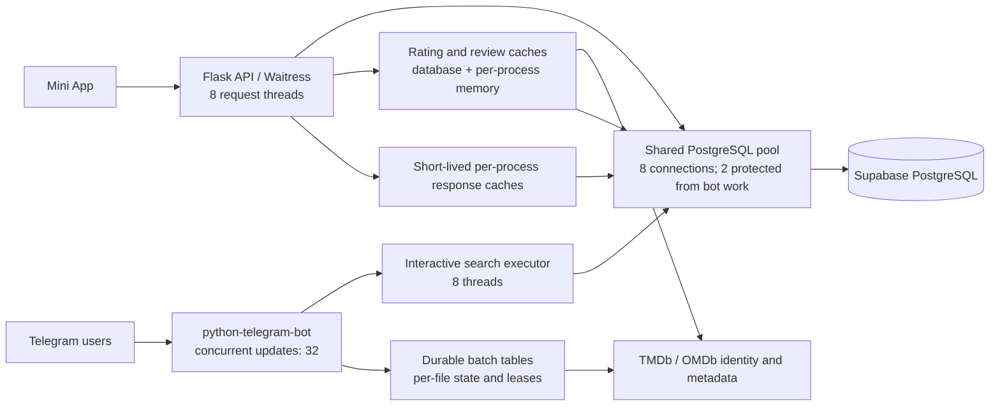

# FlimfyBox Reliability and Performance Design

## Intent

Make FlimfyBox's Mini App, Telegram search, movie details, provider metadata, and high-volume file ingestion feel fast and recover predictably when one dependency is slow. “Netflix-inspired” means adopting measurable latency, caching, isolation, and recovery practices that fit this project; it does not mean copying Netflix's global infrastructure or claiming equivalent capacity.

## Goals

- Return local search results quickly, including one- and two-character prefixes.
- Keep catalogue details, file delivery, ratings, and reviews independent so an outage in one does not hide the others.
- Keep one bad file or metadata record from stopping later batch items.
- Measure route latency, database-pool waits, cache state, provider failures, and batch outcomes without logging search text or secrets.
- Scale components only when measurements show the current single-service design is the limit.
- Apply database access restrictions table by table after confirming all consumers and the service role.

## Non-goals

- Recreate Netflix's CDN, microservice count, or internal platform.
- Promise zero errors while Telegram, Supabase, Render, TMDb, or OMDb can be unavailable.
- Add paid infrastructure, change production secrets, merge catalogue records, or apply broad database privileges as an unreviewed optimization.
- Move every component into a new framework before current bottlenecks are measured.

## Current System Map

The Render service starts Flask and Telegram polling from `python main.py`. Flask uses Waitress with 8 threads. The shared psycopg2 pool is capped at 8 connections; bot checkouts are separately limited so two slots remain available to web requests. Telegram updates can run concurrently, and interactive database work has a dedicated 8-thread executor.

The Mini App search endpoint handles autocomplete with a normalized title-prefix query. The database already has `idx_movies_title_norm_prefix`. Telegram search now uses that index for one- and two-character prefixes, while longer searches use normalized contains/trigram matching. It returns up to 100 candidate records into the existing five-item inline keyboard pages. A multiple-match search always asks the user to choose, even when one result is an exact title; each option includes year, Movie/Series type, and whether downloadable files are attached. A single distinct catalogue result can still open directly. A short-prefix miss skips the broad title/alias lookup and Google suggestions.

Movie details are loaded from local PostgreSQL data and file rows, with a 2-second server response cache and 5-second browser cache. Ratings and reviews load independently, use persistent provider caches, and can refresh in the background. Provider failures should not hold the core detail response. The metadata refresh worker uses durable database state and skips provider-ID collisions rather than retrying the same unique-constraint failure. OMDb 401 responses now enter a bounded cooldown; TMDb can continue independently.

The recent live database inventory estimates roughly 9,003 movies, 67,920 files, and 5,323 aliases. Existing normalized title prefix and trigram indexes are present. A read-only `EXPLAIN ANALYZE` for `re%` used the prefix index and completed in 3.586 ms; the prior `%re%` form used a sequential scan and completed in 41.468 ms (one warm-cache query each, not end-to-end bot latency). Recent Supabase logs showed no PostgREST requests in their 24-hour window, but this cannot prove that no external client uses the Data API. The security advisor still reports 36 tables with RLS disabled and 8 RLS-enabled tables without policies.

## Approaches

1. **Incremental, measurement-led upgrades (selected).** Keep Flask, python-telegram-bot, and Supabase Postgres. First remove code-confirmed unnecessary work, then use measured route and queue data to choose database, cache, or process-isolation changes. This has the lowest regression and operating-cost risk.
2. **Split the app into API, bot, and worker services immediately.** This can isolate resource contention, but introduces deployment, queue, health-check, connection-pool, and cost changes before we have route-level evidence that the single service is the current bottleneck.
3. **Replace the stack with a Netflix-style distributed platform.** This is disproportionate to the current catalogue and verified workload, and adds more failure modes than it removes.

## Phased Roadmap

### Phase 0 — Safety and visibility (shipped)

- Add privacy-safe request IDs and API duration logs.
- Keep slow search/database work off the Telegram event loop and preserve the Mini App's database-pool capacity.
- Keep provider calls bounded and return cached/stale metadata where possible.
- Stop duplicate provider-ID conflicts from retrying indefinitely; preserve records for review.
- Pause repeated OMDb requests after an unauthorized response without changing production secrets.
- **Open security gate:** broad production RLS/grant lockdown was rejected by automatic review because external Data API consumers and the Render database role were not verified. No database DDL was applied.

### Phase 1 — Fast read paths and failure feedback (current)

- Use the existing normalized B-tree prefix index for Telegram searches of one or two characters.
- Do not repeat broad fuzzy/database/provider work when a short prefix has no match.
- Return up to 100 matching catalogue records to Telegram's existing five-item pages; require a user choice whenever there is more than one distinct result, including exact-title matches with sequels/remakes.
- Show each candidate's year, Movie/Series type, and file availability so the user can choose the intended title and a deliverable version.
- Preserve full contains/fuzzy behavior for longer search terms and preserve Mini App API contracts.
- Read live per-route and pool-wait metrics from Render before making further query/cache changes.
- Establish baseline p50/p95 latency and error rates before setting numeric service targets.

### Phase 2 — Isolate long-running work

- Keep bot polling, Flask request handling, and metadata/batch workers from competing for the same CPU and default thread-pool capacity.
- Prefer the existing durable batch tables and item leases for work that must survive restarts.
- Add a separate Render worker only after observed queue age, pool waits, or route latency demonstrate contention; review plan cost first.
- Preserve the five-minute cap for identity resolution only; saves remain governed by per-operation limits and checkpoints.

### Phase 3 — Shared cache and provider protection

- Use cache hit/miss, stale-served, and provider failure data to choose which responses need cross-process caching.
- Keep persisted provider metadata in Postgres; introduce a shared cache only if repeated cross-instance misses justify its cost and invalidation complexity.
- Maintain single-flight refresh, stale-while-revalidate, bounded retries, per-provider failure state, and last-known-good data.

### Phase 4 — Database access and catalogue quality

- Verify all Data API consumers and the exact database role used by Render.
- Separate public catalogue reads from private/user data and internal ingestion state; design and test grants/RLS per table.
- Review duplicate-title groups using title, year, media type, and provider IDs; never merge by normalized title alone.
- Add or remove indexes only from query plans, table growth, and measured workload—not advisor output alone.

### Phase 5 — Load, recovery, and release checks

- Run representative search, detail, rating, review, and batch tests with upstream timeouts and database contention injected.
- Check p50/p95, error rate, queue age, pool waits, and cache hit ratios across a canary deploy.
- Roll forward only when core details and file delivery remain available under provider failures and one failed batch item does not stop later items.

## Phase 1 Acceptance

- A one- or two-character bot search uses a prefix pattern compatible with `idx_movies_title_norm_prefix`.
- A short-prefix miss does not launch the legacy full contains/alias search or external Google suggestion request.
- Searches with multiple catalogue matches display a paginated chooser rather than auto-selecting an exact or high-scoring title; chooser labels include year, media type, and file availability.
- A production read-only Spider-Man search returned all 17 matching records under the 100-result cap. The updated query used the title trigram index and movie-file index; one run measured 1.839 ms execution (4.506 ms planning), while a preceding run had a 51 ms execution outlier. This is variable database query time, not end-to-end Telegram latency.
- Longer searches retain their existing contains/trigram and typo fallback behavior.
- Telegram results keep their existing movie-selection callback and five-item paging, with year/type/availability labels added; Mini App response shapes and request actions remain unchanged.
- Regression tests prove both the fast prefix query and the no-fallback miss behavior.

## Risks and Boundaries

- Render dashboard logs require authentication; the current session can verify `/healthz` but cannot inspect live request-latency logs.
- OMDb was returning HTTP 401 in prior production logs; cooldown protects availability but cannot make that provider return data until its key is corrected.
- The Python suite has a Windows asyncio hang in additional batch/Upcoming tests; tests must be run in a supported project runtime before release claims.
- Netflix's published architecture is evidence for principles such as cache locality, observability, and isolating enrichment from critical paths, not a blueprint to transplant. See [Netflix API observability and SLO/SLI design](https://netflixtechblog.com/how-netflix-scales-its-api-with-graphql-federation-part-2-bbe71aaec44a), [Netflix cache-miss measurement](https://netflixtechblog.com/driving-content-delivery-efficiency-through-classifying-cache-misses-ffcf08026b6c), and [Netflix's event pipeline keeping enrichment off the serving path](https://netflixtechblog.com/behind-the-scenes-evolving-netflixs-ads-event-pipeline-for-live-part-ii-826ebf9ad9fb).
